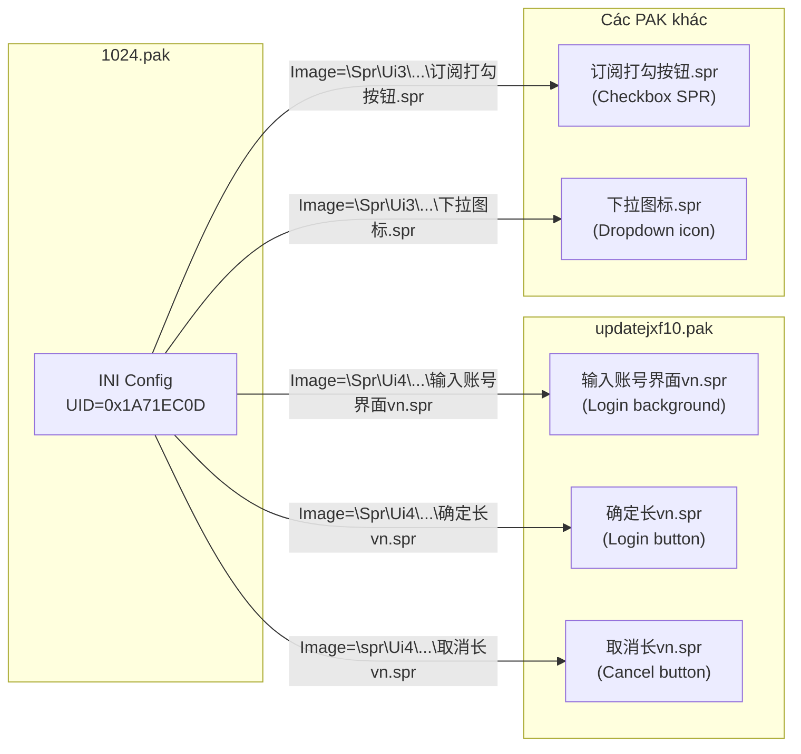

# Phân Tích Chi Tiết: Hệ Thống Cross-PAK Reference & INI-Based UI Composition

## 1. Phát Hiện Quan Trọng: Virtual Filesystem Xuyên PAK

### Cơ chế hoạt động



### Chi tiết kỹ thuật

1. **`1024.pak`** chứa file INI (dạng text, encoding GBK/mixed) định nghĩa giao diện đăng nhập.
2. INI dùng **virtual path** dạng `\Spr\Ui4\主界面\登入界面\输入账号界面vn.spr` — path **KHÔNG tồn tại trên disk** mà tham chiếu vào **virtual filesystem** được tạo bởi tập hợp các file `.pak`.
3. Game engine khi chạy sẽ:
   - Đọc INI config từ `1024.pak`
   - Parse từng section `[Main]`, `[Login]`, `[Cancel]`...
   - Với mỗi key `Image=...`, tính **UID hash** (`FileNameToPackId`) từ virtual path
   - Tìm UID đó trong **tất cả** các file `.pak` trong thư mục `data/`
   - Decompress SPR data → render lên giao diện

4. **Hàm đã có sẵn:** [`TryReadVirtualPathAcrossKnownPakRoots()`](file:///e:/Jx1/Source_unpak%20UI_Live_VLMP/pak_engine.cpp#L725-L826) — ĐÃ hỗ trợ tìm kiếm xuyên PAK bằng cách:
   - Thử đọc từ disk (game root directories)
   - Generate candidate UIDs (GBK/ACP/UTF-8 encodings)
   - Ưu tiên search trong `update*.pak` trước → `resource*.pak` → `settings*.pak` → others

---

## 2. JX1 UI INI Format — Chi Tiết Cấu Trúc

### Bảng phân tích các section type

| Section Type | Keys Quan Trọng | Ý Nghĩa |
|---|---|---|
| `[Main]` | `Left`, `Top`, `Width`, `Height`, `Image`, `Moveable`, `StartPos` | Panel gốc / cửa sổ chính |
| `[Login]`, `[Cancel]` | `Left`, `Top`, `Width`, `Height`, `Up`, `Down`, `Over`, `OverFrame`, `Image`, `Tip` | Button với multi-state SPR (Up/Down/Over = frame index) |
| `[Account]`, `[Password]` | `Left`, `Top`, `Width`, `Height`, `Font`, `Type`, `Password`, `MaxLen`, `Color` | Input field (TextBox) |
| `[Remember]`, `[Invisible]` | `CheckBox=1`, `Up`, `Down`, `Image` | Checkbox control |
| `[RememberTxt]`, `[InvisibleTxt]` | `Left`, `Top`, `Width`, `Color`, `Text` | Static text label |
| `[AccountList]` | `Selable=1`, `MaxMsgCount`, `MsgColor`, `SelColor`, `HighLight` | Dropdown/ListBox |
| `[BtnOpenAccountList]` | `Image`, `Up`, `Down`, `Over`, `Tip` | Dropdown trigger button |
| `[LoginTip]` | `Tip`, `PosX`, `PosY`, `Time` | Tooltip overlay |

### Widget Properties chung

| Key | Type | Ý nghĩa |
|---|---|---|
| `Left`, `Top` | int | Vị trí tương đối trong parent |
| `Width`, `Height` | int | Kích thước pixel |
| `Image` | string | Virtual path đến file `.spr` |
| `Up`, `Down`, `Over` | int | Frame index trong SPR cho trạng thái button |
| `OverFrame` | int | Số frame animation khi hover |
| `Trans` | 0/1 | Transparent background |
| `Color` | R,G,B | Text color |
| `BorderColor` | R,G,B | Border color |
| `Font` | int | Font size |
| `CheckBox` | 0/1 | Là checkbox control |
| `Text` | string | Static text content (encoding GBK/mixed) |
| `Tip` | string | Tooltip text |
| `HAlign` | int | Horizontal alignment (1=center?) |
| `Type` | int | Input type (1=password, 2=text?) |
| `Moveable` | 0/1 | Cho phép kéo di chuyển |

---

## 3. Đề Xuất: Split Preview Panel

### Thiết kế

```
┌─ Preview ──────────────────────────────────┐
│ [Animation] [|<<] [>>|] [Zoom ▼] [Sheet]  │
├────────────────────────────────────────────┤
│                                            │
│   Khung TRÊN: Raw Data View                │
│   - Nếu là text/INI → hiện nội dung text  │
│   - Nếu là SPR → hiện hình ảnh frame      │
│   - Nếu là image → hiện ảnh               │
│                                            │
├─── ═══════════════════════════════════ ────┤
│                                            │
│   Khung DƯỚI: UI Composite Renderer        │
│   - Parse INI sections                     │
│   - Resolve Image= paths xuyên PAK        │
│   - Render SPR sprites tại đúng vị trí    │
│   - Hiện Text labels, buttons, inputs     │
│   - Background = [Main].Image SPR          │
│                                            │
├────────────────────────────────────────────┤
│ Frame 1/5 - SPR 440x267  [Play] [Stop]    │
└────────────────────────────────────────────┘
```

### Khi nào hiện khung dưới?
- Chỉ khi preview content là file `.ini` có chứa key `Image=\...spr`
- Tự động parse INI → tìm tất cả `Image=` paths → resolve xuyên PAK → vẽ composite

### Thay đổi cần thiết

#### Files cần thêm/sửa:

| File | Thay đổi |
|---|---|
| [`resource.h`](file:///e:/Jx1/Source_unpak%20UI_Live_VLMP/resource.h) | Thêm `IDC_STATIC_UI_COMPOSITE` |
| [`FindInProcess.rc`](file:///e:/Jx1/Source_unpak%20UI_Live_VLMP/FindInProcess.rc) | Thêm Static control mới cho UI composite panel |
| [`main.cpp`](file:///e:/Jx1/Source_unpak%20UI_Live_VLMP/main.cpp) | Thêm `hUiComposite` HWND, split layout, INI parser, UI renderer |
| **[NEW]** `ui_ini_renderer.h/.cpp` | Module mới: parse INI UI format, resolve SPR cross-PAK, render composite bitmap |

---

## Open Questions

> [!IMPORTANT]
> **Tỷ lệ chia đôi:** Bạn muốn chia 50/50 hay để khung trên nhỏ hơn (30%) và khung dưới lớn hơn (70%) để UI composite hiện rõ hơn?

> [!IMPORTANT]
> **Mức độ render UI composite:** Có cần render đầy đủ (text labels, colors, input box outlines) hay chỉ cần render các SPR images tại đúng vị trí (Left, Top)?

> [!IMPORTANT]
> **Chỉ INI hay cả các format khác?** Có file nào khác ngoài `.ini` cũng define UI layout không (ví dụ `.cfg`, `.lua`)?
