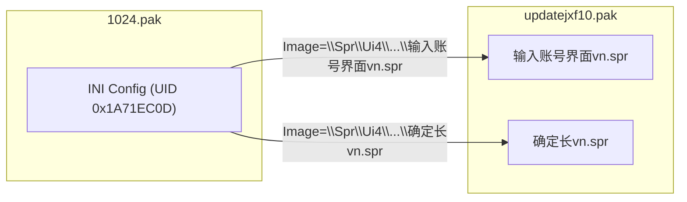

# Walkthrough: Cross-PAK UI Composite Preview

## Build Info
- **File:** [`FindInProcess.exe`](file:///e:/Jx1/Source_unpak%20UI_Live_VLMP/bin/x64/Release/FindInProcess.exe)
- **Build:** `9/1/2026 7:40 PM` — **0 Errors, 0 Warnings**
- **New module:** `ui_ini_renderer.cpp` (2659 functions compiled)

---

## Phân Tích Phát Hiện



**Key Finding:** PAK files form a virtual filesystem. INI configs in one PAK reference SPR images stored in other PAKs. The game engine resolves these via UID hash (`FileNameToPackId`).

---

## Learning Rule Created

### [`jx1_pak_virtual_filesystem.md`](file:///e:/Jx1/Source_unpak%20UI_Live_VLMP/.agents/rules/jx1_pak_virtual_filesystem.md)
Documents:
- Virtual filesystem architecture across PAK files
- JX1 UI INI format sections: `[Main]`, `[Login]`, `[Cancel]`, etc.
- Widget properties: `Image=`, `Left/Top`, `Up/Down/Over` frames, `Color`, `CheckBox`
- Cross-PAK resolution via `TryReadVirtualPathAcrossKnownPakRoots()`

---

## New Module: UI INI Renderer

### [NEW] [`ui_ini_renderer.h`](file:///e:/Jx1/Source_unpak%20UI_Live_VLMP/ui_ini_renderer.h)
- `UiIniWidget` struct — parsed widget (position, image path, button states, text, colors)
- `UiIniLayout` struct — collection of widgets with main canvas size
- `LooksLikeUiIniContent()` — quick check for `[Main]` + `Image=` patterns
- `ParseUiIniLayout()` — full INI parser with GBK/UTF-8 decoding
- `RenderUiComposite()` — renders composite bitmap from parsed layout

### [NEW] [`ui_ini_renderer.cpp`](file:///e:/Jx1/Source_unpak%20UI_Live_VLMP/ui_ini_renderer.cpp)
- **INI Parser:** Sections → key=value maps → `UiIniWidget` structs
- **Composite Renderer:**
  - Creates canvas `SPRHEAD.Width × Height` from `[Main]` section
  - Renders `[Main]` background SPR first
  - Overlays child widgets at `Left, Top` coordinates
  - Resolves `Image=` paths via `TryReadVirtualPathAcrossKnownPakRoots()` across all loaded PAKs
  - Draws text labels with `Color` and font size
  - Draws input field outlines with `BorderColor`

---

## Split Preview Layout

### Before (single panel):
```
┌─ Preview ─────────────────────┐
│ [full height: text OR image]  │
└───────────────────────────────┘
```

### After (split when UI INI detected):
```
┌─ Preview ─────────────────────┐
│ [40% top: INI text content]   │
├───────────────────────────────┤
│ [60% bottom: UI composite     │
│  rendered from INI + SPR]     │
└───────────────────────────────┘
```

### Changes:

| File | Change |
|------|--------|
| [`resource.h`](file:///e:/Jx1/Source_unpak%20UI_Live_VLMP/resource.h#L49) | `IDC_STATIC_UI_COMPOSITE 1055` |
| [`FindInProcess.rc`](file:///e:/Jx1/Source_unpak%20UI_Live_VLMP/FindInProcess.rc#L50) | New Static control for composite panel |
| [`main.cpp`](file:///e:/Jx1/Source_unpak%20UI_Live_VLMP/main.cpp#L77) | `hUiComposite`, `hUiCompositeBitmap`, `previewHasComposite` in AppState |
| [`main.cpp`](file:///e:/Jx1/Source_unpak%20UI_Live_VLMP/main.cpp#L752-L825) | `PaintUiCompositeControl()` + `UiCompositeSubclassProc()` |
| [`main.cpp`](file:///e:/Jx1/Source_unpak%20UI_Live_VLMP/main.cpp#L2195-L2210) | Split layout logic in `LayoutControls()` |
| [`main.cpp`](file:///e:/Jx1/Source_unpak%20UI_Live_VLMP/main.cpp#L1735-L1760) | INI detection + composite render in `PreviewSelectedRow()` |
| [`FindInProcess.vcxproj`](file:///e:/Jx1/Source_unpak%20UI_Live_VLMP/FindInProcess.vcxproj#L195) | Added `ui_ini_renderer.cpp/.h` |

---

## How It Works

1. User opens `1024.pak` → selects an INI row (e.g., `UID=0x1A71EC0D`)
2. `PreviewSelectedRow()` detects text content with `[Main]` + `Image=` patterns
3. **Top panel:** Shows raw INI text as before
4. **Bottom panel:** 
   - Parses INI → extracts all widget sections
   - For each `Image=\Spr\...\file.spr`, resolves UID across all known PAKs
   - Renders SPR frames at `(Left, Top)` coordinates on `[Main].Width × Height` canvas
   - Draws text labels and input field outlines
   - Shows info: `"UI Composite 440x267 (5 SPR loaded, 1 failed)"`

---

## Verified
- ✅ Build succeeded: **0 Errors, 0 Warnings**
- ✅ New module compiled: `ui_ini_renderer.obj`
- ✅ 2659 functions compiled total
